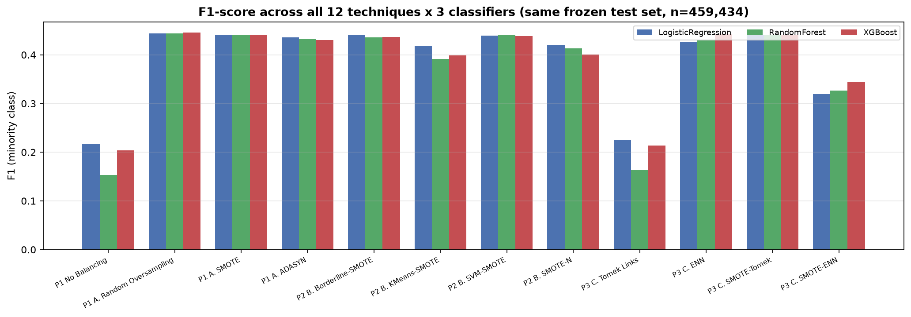
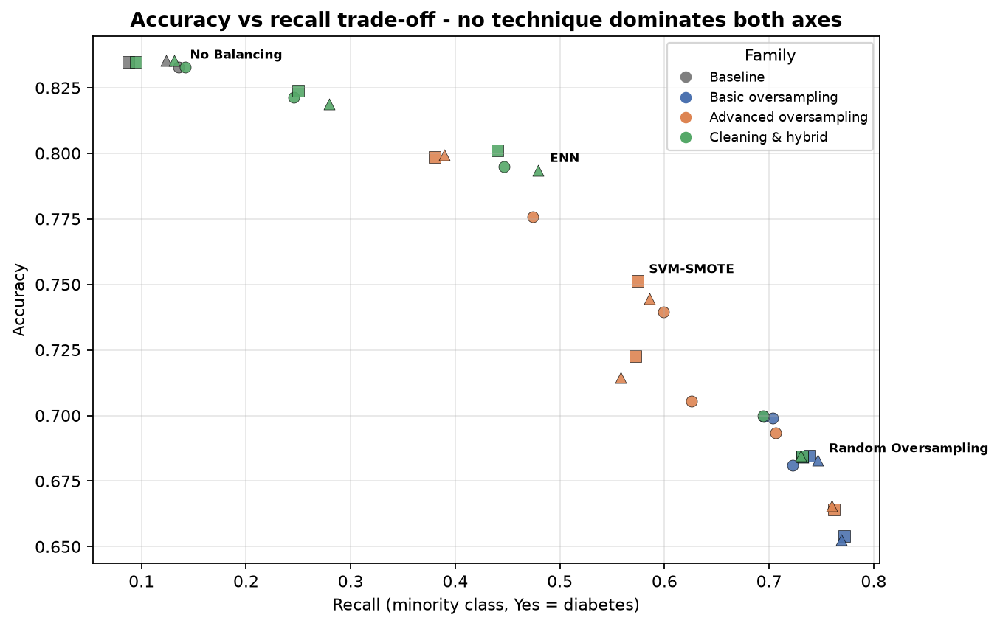
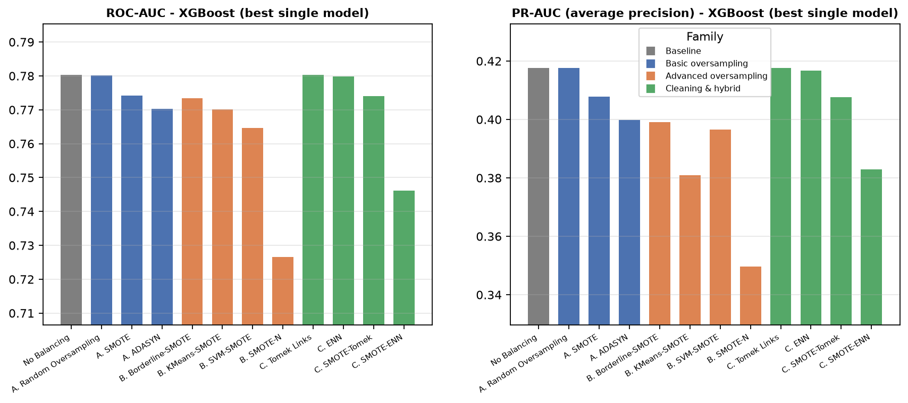
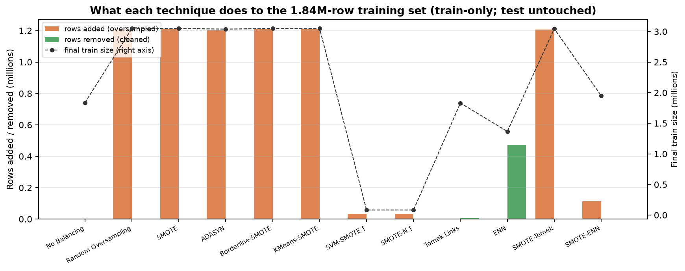
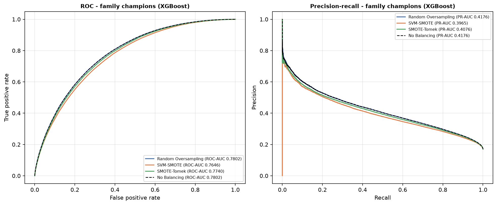
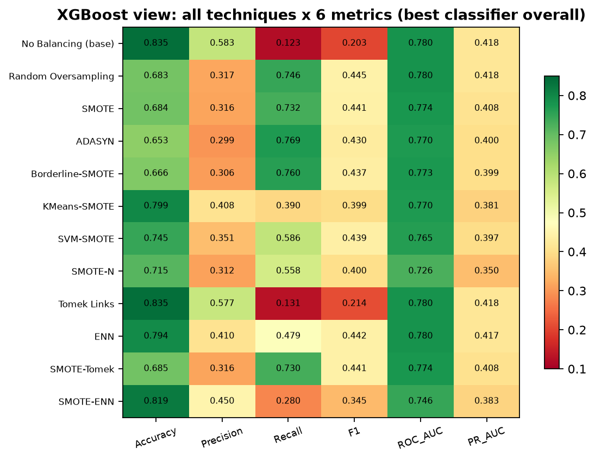

# Person 4 — Integrated Evaluation
## Class-Imbalance Resampling for BRFSS Diabetes Prediction (P1 + P2 + P3)

Generated 2026-10-17T19:23:24.193543+00:00 from validated artifacts. Every number below is traceable to a
source file listed in §2 and re-verified by `01_verify_inputs.py`
(see `results/input_validation.json`).

---

## 1. Executive summary

Three team members each implemented one family of class-imbalance techniques on the
**same BRFSS 2015–2024 dataset (2,297,168 rows), the same frozen stratified test set
(459,434 rows, SHA-256 fingerprint `70e180c6…`), the same three classifiers, the same
metrics, and seed 42**, applying resampling to the training data only:

- **P1 — basic oversampling:** No Balancing (baseline), Random Oversampling (ROS), SMOTE, ADASYN
- **P2 — advanced oversampling:** Borderline-SMOTE, KMeans-SMOTE, SVM-SMOTE†, SMOTE-N†
- **P3 — cleaning & hybrid:** Tomek Links, ENN, SMOTE-Tomek, SMOTE-ENN

This report integrates all **36 result rows (12 techniques × 3 classifiers)** into one
comparison, tests them statistically, and states what each result means.

**Five headline findings**

1. **Oversampling (basic and advanced), the hybrids and ENN roughly double
   minority-class F1** relative to the unbalanced baseline
   (0.153-0.217 → **0.319–0.445**), at the cost of precision and
   accuracy. The gain is driven by detecting far more of the 78,366 diabetic cases in the
   test set (recall 0.09–0.12 → up to 0.77).
   The sole exception is **Tomek Links**, whose F1 (0.224) stays at baseline level —
   it only deletes 7,161 border rows (Finding 4).
2. **Plain Random Oversampling is the F1 champion for all three classifiers**
   (0.4435 / 0.4441 / 0.4453) —
   the most sophisticated oversamplers add essentially nothing on F1 and are
   statistically indistinguishable from ROS/SMOTE in label behaviour (§6).
3. **No technique wins on every metric — the choice depends on the target metric.**
   Accuracy and probability-ranking quality (ROC/PR-AUC) are highest for the baseline
   family and data-cleaning methods; raw minority detection (recall) is highest for
   aggressive oversamplers (ADASYN 0.7716 with RandomForest); F1 peaks at the
   ROS/SMOTE family (Figure 2 shows the trade-off).
4. **Cleaning (Tomek Links, ENN) protects the baseline's ranking quality.** Tomek Links is
   statistically indistinguishable from the baseline on all three classifiers
   (§6) despite removing only 7,161 of 1.52M majority rows (0.47%); ENN (XGBoost) reaches
   F1 0.4420 with accuracy 0.794
   (vs ROS accuracy 0.683) — the best *accuracy-preserving* F1 in the study.
5. **Oversampling mostly moves the operating point, not the ranking curve.** For
   XGBoost, Random Oversampling's PR-AUC (0.4176) is
   virtually identical to the baseline's (0.4176): resampling
   converts ranking quality into better 0.5-threshold decisions rather than creating a
   better-ranked model. This reframes what resampling "buys" — a shift of the decision
   threshold behaviour, not an intrinsically better model.

---

## 2. Data, shared protocol, and provenance

**Dataset.** BRFSS 2015–2024 master survey, YEAR 2014 excluded → 2,297,168 rows.
Target `DIABETE4` (Yes = 1, 17.06% prevalence). Fifteen integer-coded categorical
predictors (EXERANY2, _MICHD, ASTHMA3, ADDEPEV3, CHCKDNY2, MARITAL, _EDUCAG, DRNKANY6,
_AGEG5YR, _BMI5CAT, _INCOMG1, _RFSMOK3, GENHLTH, HAVARTH4, SEXVAR); `YEAR` is metadata
and never a predictor.

**Split.** Person 1's frozen `train_test_split(test_size=0.20, random_state=42,
stratify=y, shuffle=True)` → train 1,837,734 (No 1,524,272 / Yes 313,462) and test
459,434 (No 381,068 / Yes 78,366). The test set was never resampled by anyone.

**Where each reported value comes from.** Every row of the integrated table is copied
from the person's own validated results file and cross-checked by recomputing all six
metrics from that person's saved prediction file on the shared test set:

| Person | Results file | Prediction files used | Verified by |
|---|---|---|---|
| P1 | `P1_Basic_Oversampling/11_Audit_2015_2024_Rerun/07_combined_results_audit/combined_results_2015_2024.csv` | `03–06_*_audit/test_predictions_2015_2024.parquet` (4) | 82-check gate (see step 1) |
| P2 | `P2_Advanced_Oversampling/results/results_person2.csv` (+baseline CSV) | `results/test_predictions_*.parquet` (5) | P2's own 119/119 gate, re-verified here |
| P3 | `P3_Advanced_Resampling/results/results_person3.csv` | `results/test_predictions_*_*.parquet` (4) | re-verified here |

**Fingerprint chain.** Person 3's protocol froze the test-set SHA-256
(`70e180c6…`); Person 2's build verified it before running; P4 re-derives it from
Person 1's split parquets (`11_Audit_2015_2024_Rerun/02_preprocessing_audit/`) —
all three agree. All 13 prediction files carry an identical `y_true` vector, so every
McNemar test in §6 compares two classifiers on **exactly the same patients**.

**Invariant caveat (XGBoost).** Reproducing P1's corrected baseline on different
hardware gives bit-identical LogisticRegression and RandomForest predictions but a
slightly different XGBoost model (~1.9e-3 in metrics, 1,238 label flips) because XGBoost
`hist` is not bit-reproducible across thread counts. Cross-person XGBoost differences
below ~0.002 are therefore machine noise, not method differences.

---

## 3. The three approaches and their techniques

| Family | Person | Technique (config) | Training data | Together with |
|---|---|---|---|---|
| A. Basic oversampling | P1 | Random Oversampling (`sampling_strategy="auto"`, seed 42) | full 1.84M train | ROS duplicates minority rows |
| A | P1 | SMOTE (`k_neighbors=5`, seed 42) | full | interpolates synthetic minority points |
| A | P1 | ADASYN (`n_neighbors=5`, seed 42) | full | interpolates, weighted to hard samples |
| B. Advanced oversampling | P2 | Borderline-SMOTE (defaults: borderline-1, k=5, m=10) | full | synthesises near the class border only |
| B | P2 | KMeans-SMOTE (`kmeans_estimator=100`, `cluster_balance_threshold=0.2`*) | full | synthesises inside minority-dense clusters |
| B | P2 | SVM-SMOTE† (defaults incl. `out_step=0.5`) | 50k subsample | synthesises along minority support vectors |
| B | P2 | SMOTE-N† (k=5, categorical-native) | 50k subsample | majority-votes category codes |
| C. Cleaning & hybrid | P3 | Tomek Links (`sampling_strategy="auto"`) | full | removes majority–minority border pairs |
| C | P3 | ENN (`sampling_strategy="auto"`) | full | removes majority rows misclassified by 3-NN |
| C | P3 | SMOTE-Tomek (SMOTE + Tomek, seed 42) | full | SMOTE then border cleaning |
| C | P3 | SMOTE-ENN (SMOTE + ENN, staged, seed 42) | full | SMOTE then aggressive cleaning |
| — | P1 | No Balancing (baseline) | full | none |

\* library defaults fail on this all-categorical feature space (documented).
† O(n²) cost/memory; both P2 techniques marked with the dagger use one shared
stratified 50,000-row training subsample — their results are indicative but not
strictly like-for-like with the full-train rows (§4, §9).

Classifiers (identical for all 36 rows): LogisticRegression (`max_iter=1000`,
`lbfgs`, seed 42; `StandardScaler` fitted on the resampled training data),
RandomForest (100 trees, depth 12), XGBoost (300 rounds, depth 6, lr 0.05, `hist`).

---

## 4. Is the comparison fair?

**What is controlled — identical for every row:** dataset and scope; the frozen,
fingerprint-verified test set; the 15 features and their integer-coded representation;
classifier hyperparameters; metrics and the 0.5 decision threshold; seed 42; train-only
resampling; CSV/parquet output schema. The 82-check verification step recomputed every
metric from saved predictions and matched every source CSV, and confirmed the P2
baseline replication of P1's baseline (LR/RF bit-identical).

**What differs, and how it is handled:**

1. **Family scope** is the point of comparison (basic vs advanced vs cleaning), so the
   families are grouped in every table/figure rather than treated as one flat list.
2. **50k subsample for SVM-SMOTE and SMOTE-N†** — these two rows are flagged wherever
   they appear; conclusions never rest on them.
3. **KMeans-SMOTE non-default parameters** were forced by a library failure on
   all-categorical data; documented in P2's protocol and reproduced here as-is.
4. **SVM-SMOTE extrapolation** produces a small share (2.49%) of one-code-below-range
   synthetic values; inherent to `out_step=0.5`, reported in P2's audit.
5. **XGBoost cross-machine noise** (~2e-3) — differences below this are not interpreted.
6. **Float32 vs float64 probability storage** (P1/P2 vs P3) — all metrics were computed
   consistently from each person's own CSVs; recomputation tolerances reflect storage.
7. **Timings are machine-dependent** and excluded from every comparison.

---

## 5. Integrated results

**How to read the metrics.** *Accuracy* is dominated by the 83% non-diabetic majority —
a model predicting "No" for everyone scores 0.83, so accuracy alone flatters the
baseline. *Recall (sensitivity)* is the share of true diabetic cases detected — the
metric that matters most clinically for screening. *Precision* is how many flagged
cases are truly diabetic. *F1* balances precision and recall on the minority class.
*ROC-AUC* measures ranking across all thresholds; *PR-AUC (average precision)* is the
more informative ranking metric under 17% prevalence.

### Main table — all 36 rows

| Display | Person | Model | Accuracy | Precision | Recall | F1 | ROC_AUC | PR_AUC |
|---|---|---|---|---|---|---|---|---|
| No Balancing | P1 | LogisticRegression | 0.8330 | 0.5416 | 0.1354 | 0.2166 | 0.7713 | 0.4010 |
| No Balancing | P1 | RandomForest | 0.8347 | 0.6076 | 0.0876 | 0.1531 | 0.7775 | 0.4137 |
| No Balancing | P1 | XGBoost | 0.8354 | 0.5832 | 0.1232 | 0.2034 | 0.7802 | 0.4176 |
| Random Oversampling | P1 | LogisticRegression | 0.6990 | 0.3239 | 0.7033 | 0.4435 | 0.7715 | 0.3995 |
| Random Oversampling | P1 | RandomForest | 0.6847 | 0.3176 | 0.7385 | 0.4441 | 0.7777 | 0.4137 |
| Random Oversampling | P1 | XGBoost | 0.6829 | 0.3173 | 0.7463 | 0.4453 | 0.7802 | 0.4176 |
| SMOTE | P1 | LogisticRegression | 0.6995 | 0.3230 | 0.6951 | 0.4410 | 0.7685 | 0.3974 |
| SMOTE | P1 | RandomForest | 0.6843 | 0.3162 | 0.7315 | 0.4415 | 0.7751 | 0.4084 |
| SMOTE | P1 | XGBoost | 0.6840 | 0.3160 | 0.7321 | 0.4415 | 0.7742 | 0.4079 |
| ADASYN | P1 | LogisticRegression | 0.6812 | 0.3122 | 0.7224 | 0.4359 | 0.7669 | 0.3952 |
| ADASYN | P1 | RandomForest | 0.6541 | 0.3001 | 0.7716 | 0.4321 | 0.7727 | 0.4032 |
| ADASYN | P1 | XGBoost | 0.6528 | 0.2988 | 0.7689 | 0.4303 | 0.7703 | 0.3998 |
| Borderline-SMOTE | P2 | LogisticRegression | 0.6933 | 0.3195 | 0.7062 | 0.4399 | 0.7686 | 0.3962 |
| Borderline-SMOTE | P2 | RandomForest | 0.6640 | 0.3055 | 0.7618 | 0.4361 | 0.7740 | 0.4023 |
| Borderline-SMOTE | P2 | XGBoost | 0.6655 | 0.3063 | 0.7601 | 0.4367 | 0.7734 | 0.3991 |
| KMeans-SMOTE | P2 | LogisticRegression | 0.7757 | 0.3753 | 0.4740 | 0.4189 | 0.7569 | 0.3773 |
| KMeans-SMOTE | P2 | RandomForest | 0.7986 | 0.4039 | 0.3803 | 0.3918 | 0.7635 | 0.3752 |
| KMeans-SMOTE | P2 | XGBoost | 0.7995 | 0.4080 | 0.3896 | 0.3986 | 0.7701 | 0.3809 |
| SVM-SMOTE † | P2 | LogisticRegression | 0.7396 | 0.3473 | 0.5992 | 0.4398 | 0.7631 | 0.3914 |
| SVM-SMOTE † | P2 | RandomForest | 0.7512 | 0.3573 | 0.5741 | 0.4405 | 0.7676 | 0.3980 |
| SVM-SMOTE † | P2 | XGBoost | 0.7446 | 0.3509 | 0.5857 | 0.4389 | 0.7646 | 0.3965 |
| SMOTE-N † | P2 | LogisticRegression | 0.7054 | 0.3162 | 0.6255 | 0.4201 | 0.7374 | 0.3716 |
| SMOTE-N † | P2 | RandomForest | 0.7226 | 0.3231 | 0.5720 | 0.4130 | 0.7383 | 0.3597 |
| SMOTE-N † | P2 | XGBoost | 0.7146 | 0.3119 | 0.5583 | 0.4002 | 0.7265 | 0.3496 |
| Tomek Links | P3 | LogisticRegression | 0.8329 | 0.5385 | 0.1416 | 0.2242 | 0.7713 | 0.4011 |
| Tomek Links | P3 | RandomForest | 0.8349 | 0.6023 | 0.0946 | 0.1636 | 0.7776 | 0.4139 |
| Tomek Links | P3 | XGBoost | 0.8354 | 0.5769 | 0.1314 | 0.2140 | 0.7803 | 0.4176 |
| ENN | P3 | LogisticRegression | 0.7948 | 0.4075 | 0.4467 | 0.4262 | 0.7715 | 0.4006 |
| ENN | P3 | RandomForest | 0.8011 | 0.4207 | 0.4401 | 0.4301 | 0.7772 | 0.4127 |
| ENN | P3 | XGBoost | 0.7935 | 0.4100 | 0.4794 | 0.4420 | 0.7799 | 0.4168 |
| SMOTE-Tomek | P3 | LogisticRegression | 0.6998 | 0.3232 | 0.6943 | 0.4410 | 0.7684 | 0.3973 |
| SMOTE-Tomek | P3 | RandomForest | 0.6843 | 0.3162 | 0.7319 | 0.4416 | 0.7750 | 0.4083 |
| SMOTE-Tomek | P3 | XGBoost | 0.6848 | 0.3163 | 0.7301 | 0.4414 | 0.7740 | 0.4076 |
| SMOTE-ENN | P3 | LogisticRegression | 0.8213 | 0.4556 | 0.2455 | 0.3191 | 0.7526 | 0.3781 |
| SMOTE-ENN | P3 | RandomForest | 0.8239 | 0.4697 | 0.2501 | 0.3264 | 0.7425 | 0.3823 |
| SMOTE-ENN | P3 | XGBoost | 0.8188 | 0.4500 | 0.2797 | 0.3449 | 0.7461 | 0.3829 |

### Family means (per classifier)

| Family | Model | n_techniques | F1_mean | Recall_mean | Accuracy_mean | ROC_AUC_mean | PR_AUC_mean | F1_best_technique |
|---|---|---|---|---|---|---|---|---|
| Baseline | LogisticRegression | 1 | 0.2166 | 0.1354 | 0.8330 | 0.7713 | 0.4010 | No Balancing |
| Baseline | RandomForest | 1 | 0.1531 | 0.0876 | 0.8347 | 0.7775 | 0.4137 | No Balancing |
| Baseline | XGBoost | 1 | 0.2034 | 0.1232 | 0.8354 | 0.7802 | 0.4176 | No Balancing |
| Basic oversampling | LogisticRegression | 3 | 0.4402 | 0.7069 | 0.6932 | 0.7689 | 0.3973 | Random Oversampling |
| Basic oversampling | RandomForest | 3 | 0.4393 | 0.7472 | 0.6744 | 0.7752 | 0.4084 | Random Oversampling |
| Basic oversampling | XGBoost | 3 | 0.4390 | 0.7491 | 0.6732 | 0.7749 | 0.4085 | Random Oversampling |
| Advanced oversampling | LogisticRegression | 4 | 0.4297 | 0.6012 | 0.7285 | 0.7565 | 0.3841 | Borderline-SMOTE |
| Advanced oversampling | RandomForest | 4 | 0.4203 | 0.5720 | 0.7341 | 0.7608 | 0.3838 | SVM-SMOTE |
| Advanced oversampling | XGBoost | 4 | 0.4186 | 0.5734 | 0.7310 | 0.7587 | 0.3816 | SVM-SMOTE |
| Cleaning & hybrid | LogisticRegression | 4 | 0.3526 | 0.3820 | 0.7872 | 0.7660 | 0.3943 | SMOTE-Tomek |
| Cleaning & hybrid | RandomForest | 4 | 0.3404 | 0.3792 | 0.7861 | 0.7680 | 0.4043 | SMOTE-Tomek |
| Cleaning & hybrid | XGBoost | 4 | 0.3606 | 0.4052 | 0.7831 | 0.7701 | 0.4062 | ENN |

### Resampling mechanics (what each technique did to the training set)

| Display | Family | Rows_added | Rows_removed | Net_change | Final_train_size | Train_source |
|---|---|---|---|---|---|---|
| No Balancing | Baseline | 0 | 0 | 0 | 1837734 | full corrected train split (1,837,734 rows) |
| Random Oversampling | Basic oversampling | 1210810 | 0 | 1210810 | 3048544 | full corrected train split (1,837,734 rows) |
| SMOTE | Basic oversampling | 1210810 | 0 | 1210810 | 3048544 | full corrected train split (1,837,734 rows) |
| ADASYN | Basic oversampling | 1201468 | 0 | 1201468 | 3039202 | full corrected train split (1,837,734 rows) |
| Borderline-SMOTE | Advanced oversampling | 1210810 | 0 | 1210810 | 3048544 | full corrected train split (1,837,734 rows) |
| KMeans-SMOTE | Advanced oversampling | 1210828 | 0 | 1210828 | 3048562 | full corrected train split (1,837,734 rows) |
| SVM-SMOTE † | Advanced oversampling | 32944 | 0 | 32944 | 82944 | shared stratified 50k subsample (41,472/8,528, seed 42) |
| SMOTE-N † | Advanced oversampling | 32944 | 0 | 32944 | 82944 | shared stratified 50k subsample (41,472/8,528, seed 42) |
| Tomek Links | Cleaning & hybrid | 0 | 7161 | -7161 | 1830573 | full corrected train split (1,837,734 rows); cleaning removes majority/overlap rows |
| ENN | Cleaning & hybrid | 0 | 470885 | -470885 | 1366849 | full corrected train split (1,837,734 rows); cleaning removes majority/overlap rows |
| SMOTE-Tomek | Cleaning & hybrid | 1208265 | 0 | 1208265 | 3045999 | full corrected train split (1,837,734 rows); cleaning removes majority/overlap rows |
| SMOTE-ENN | Cleaning & hybrid | 112454 | 0 | 112454 | 1950188 | full corrected train split (1,837,734 rows); cleaning removes majority/overlap rows |

*Accounting note:* P1/P2 report gross additions for pure oversamplers; P3's hybrid
techniques (SMOTE-Tomek, SMOTE-ENN) are recorded as **net** effects by their staged
implementation — e.g. SMOTE-ENN ends at Yes 313,462 → 425,916 (+112,454 net) after
SMOTE additions and ENN removals, which are not decomposed in Person 3's artifact.
`Final_train_size` and `Net_change` are exact for every row.

---

## 6. Statistical analysis

**Method.** For each classifier we compared every technique pair with **McNemar's
test** on the paired error patterns over the same 459,434 test rows (66 pairs × 3
classifiers = 198 tests), with **Holm correction** within each classifier. Effect
sizes (accuracy and recall differences) are reported next to every p-value: with
n = 459,434, even trivially small differences become "significant", so significance
never stands alone.

**Overall:** 191/198 pairs are significant after Holm correction. The seven
non-significant pairs are themselves informative — they identify *equivalences*:

| Classifier | Non-significant pair | Adjusted p |
|---|---|---|
| LogisticRegression | No Balancing vs Tomek Links | 0.212 |
| LogisticRegression | Random Oversampling vs SMOTE | 0.212 |
| RandomForest | No Balancing vs Tomek Links | 0.078 |
| RandomForest | Random Oversampling vs SMOTE | 0.657 |
| RandomForest | Random Oversampling vs SMOTE-Tomek | 0.657 |
| RandomForest | SMOTE vs SMOTE-Tomek | 0.847 |
| XGBoost | No Balancing vs Tomek Links | 0.813 |

Two patterns emerge:
- **Tomek Links ≈ baseline** on all three classifiers: removing 7,161 of 1.52M majority
  rows (0.47%) changes almost nothing (e.g. 901 vs 891 disagreeing rows for XGBoost).
- **ROS ≈ SMOTE ≈ SMOTE-Tomek** (label patterns): at this scale the interpolating
  oversamplers produce practically the same decisions as plain duplication.

**Per-model contrasts used below (XGBoost, Holm):** ROS vs Borderline-SMOTE
(p ≈ 0, accuracy +0.017,
recall -0.014);
SMOTE vs SMOTE-Tomek (adjusted p ≈ 1e-6, recall +0.002 — Tomek cleaning after SMOTE is
cosmetic here); ENN vs Tomek Links (p ≈ 0, accuracy +0.042, recall −0.348 — ENN removes
470,885 noisy majority rows vs Tomek's 7,161-row border cleanup).

**Champion AUC differences with paired bootstrap 95% CIs** (500 resamples, seed 42):

| Classifier | Comparison | metric | mean diff | 95% CI | |
|---|---|---|---|---|---|
| LogisticRegression | Random Oversampling (champion) vs No Balancing | ROC_AUC | +0.0002 | [+0.0001, +0.0003] |excludes 0 |
| LogisticRegression | Random Oversampling (champion) vs No Balancing | PR_AUC | -0.0016 | [-0.0017, -0.0014] |excludes 0 |
| LogisticRegression | Random Oversampling (champion) vs Borderline-SMOTE | ROC_AUC | +0.0029 | [+0.0025, +0.0032] |excludes 0 |
| LogisticRegression | Random Oversampling (champion) vs Borderline-SMOTE | PR_AUC | +0.0033 | [+0.0026, +0.0039] |excludes 0 |
| LogisticRegression | Random Oversampling (champion) vs SMOTE-Tomek | ROC_AUC | +0.0030 | [+0.0027, +0.0033] |excludes 0 |
| LogisticRegression | Random Oversampling (champion) vs SMOTE-Tomek | PR_AUC | +0.0021 | [+0.0015, +0.0028] |excludes 0 |
| RandomForest | Random Oversampling (champion) vs No Balancing | ROC_AUC | +0.0001 | [-0.0000, +0.0003] |contains 0 |
| RandomForest | Random Oversampling (champion) vs No Balancing | PR_AUC | -0.0000 | [-0.0004, +0.0004] |contains 0 |
| RandomForest | Random Oversampling (champion) vs SVM-SMOTE | ROC_AUC | +0.0101 | [+0.0095, +0.0107] |excludes 0 |
| RandomForest | Random Oversampling (champion) vs SVM-SMOTE | PR_AUC | +0.0157 | [+0.0145, +0.0171] |excludes 0 |
| RandomForest | Random Oversampling (champion) vs SMOTE-Tomek | ROC_AUC | +0.0027 | [+0.0024, +0.0031] |excludes 0 |
| RandomForest | Random Oversampling (champion) vs SMOTE-Tomek | PR_AUC | +0.0054 | [+0.0046, +0.0063] |excludes 0 |
| XGBoost | Random Oversampling (champion) vs No Balancing | ROC_AUC | -0.0001 | [-0.0001, +0.0000] |contains 0 |
| XGBoost | Random Oversampling (champion) vs No Balancing | PR_AUC | +0.0000 | [-0.0002, +0.0002] |contains 0 |
| XGBoost | Random Oversampling (champion) vs SVM-SMOTE | ROC_AUC | +0.0156 | [+0.0149, +0.0163] |excludes 0 |
| XGBoost | Random Oversampling (champion) vs SVM-SMOTE | PR_AUC | +0.0211 | [+0.0196, +0.0225] |excludes 0 |
| XGBoost | Random Oversampling (champion) vs ENN | ROC_AUC | +0.0003 | [+0.0001, +0.0004] |excludes 0 |
| XGBoost | Random Oversampling (champion) vs ENN | PR_AUC | +0.0009 | [+0.0004, +0.0013] |excludes 0 |

*Champion vs rival on identical test rows; a CI containing 0 means the AUC gap is not established at the 5% level despite statistical significance of the label patterns.*

---

## 7. Findings — which approach wins under which metric, and why

**Metric winners (top technique per classifier).** "Family" shows where each winner
comes from; the full list is in the workbook (`Winners_tradeoffs`).

| Model | Metric | Winner | Value | Family |
|---|---|---|---|---|
| LogisticRegression | Accuracy | No Balancing | 0.8330 | Baseline |
| LogisticRegression | Recall | ADASYN | 0.7224 | Basic oversampling |
| LogisticRegression | F1 | Random Oversampling | 0.4435 | Basic oversampling |
| LogisticRegression | ROC_AUC | ENN | 0.7715 | Cleaning & hybrid |
| LogisticRegression | PR_AUC | Tomek Links | 0.4011 | Cleaning & hybrid |
| RandomForest | Accuracy | Tomek Links | 0.8349 | Cleaning & hybrid |
| RandomForest | Recall | ADASYN | 0.7716 | Basic oversampling |
| RandomForest | F1 | Random Oversampling | 0.4441 | Basic oversampling |
| RandomForest | ROC_AUC | Random Oversampling | 0.7777 | Basic oversampling |
| RandomForest | PR_AUC | Tomek Links | 0.4139 | Cleaning & hybrid |
| XGBoost | Accuracy | No Balancing | 0.8354 | Baseline |
| XGBoost | Recall | ADASYN | 0.7689 | Basic oversampling |
| XGBoost | F1 | Random Oversampling | 0.4453 | Basic oversampling |
| XGBoost | ROC_AUC | Tomek Links | 0.7803 | Cleaning & hybrid |
| XGBoost | PR_AUC | Random Oversampling | 0.4176 | Basic oversampling |

**Finding 1 — best F1: plain Random Oversampling (all three classifiers).**
ROS reaches F1 0.4435 (LR),
0.4441 (RF),
0.4453 (XGB). Its margin over SMOTE variants is
tiny (0.4415 for SMOTE-XGB) but consistent and Holm-significant
against most rivals because n is very large. *Why it matters:* the marginal value of
advanced oversampling over naive duplication is close to zero on this dataset — the
17% minority class already provides 313,462 positives, more than enough for simple
duplication to balance the loss without overfitting visibly.

**Finding 2 — best raw minority detection: aggressive synthetic oversampling.**
ADASYN-XGB recall 0.7689 and ADASYN/RF 0.7716,
Borderline-SMOTE/RF 0.7618 — but at precision
~0.30 and accuracy ~0.65–0.68. If the screening use-case tolerates many false
positives to catch nearly all diabetics, this family is the operating point to choose.

**Finding 3 — best accuracy-preserving option: ENN (cleaning-only).** ENN-XGB keeps
F1 at 0.4420 while holding accuracy at 0.7935 and ROC-AUC
0.7799 — it removes 470,885 ambiguous majority rows instead of
adding any synthetic ones. Under XGBoost its F1 is the runner-up overall
(0.4420 vs ROS 0.4453)
with a dramatically better accuracy/recall trade-off than any oversampler
(Figure 2, grey-green cluster).

**Finding 4 — best probability ranking: the baseline and Tomek Links.** ROC-AUC
(XGB): baseline 0.7802, Tomek 0.7803;
 Tomek Links is the only technique that is *never significantly worse* than the
 baseline on any classifier and equals or slightly exceeds its AUC — the shallowest
 possible intervention (delete 7,161 border pairs, 0.47% of the majority class) that
 leaves the ranking untouched. Aggressive oversamplers trade 0.005–0.04 of AUC for
 their recall gains.

**Finding 5 — the unifying explanation.** Resampling leaves the models' *ranking*
almost unchanged (PR-AUC XGB: ROS 0.4176 vs
baseline 0.4176) but reshapes the 0.5-threshold
decision: balancing the training classes teaches the classifier that the prior
probability of diabetes is ~50%, not 17%, so it says "Yes" far more often at the same
score. Recall and F1 therefore jump, while AUC metrics — which are threshold-free —
stay close to baseline. **For this research, technique choice is effectively a
choice of operating point, plus a modest ENN data-cleaning dividend.**

**Practical recommendation.** For a diabetes-screening model: train on the plain
baseline to get the best-calibrated probabilities, then select the operating
threshold on a validation curve — or, if a single 0.5-threshold model is required,
use Random Oversampling (best F1, no synthetic-data caveats) or ENN when
accuracy/precision must be preserved. Advanced oversamplers are justified only when
their specific inductive biases (border-focused, cluster-focused, categorical-native
generation) are themselves the research object.

---

## 8. Figures

| Figure | What it shows | How to read it |
|---|---|---|
|  **Fig. 1** | F1 for all 12 techniques × 3 classifiers | the study in one picture: the baseline bars are ~half the height of every resampled bar; within the resampled cluster the differences are small |
|  **Fig. 2** | accuracy vs recall, every technique | no technique dominates both axes; families occupy different regions — oversamplers top-left (high recall, low accuracy), baseline/cleaning bottom-right |
|  **Fig. 3** | ROC-AUC and PR-AUC (XGBoost) | cleaning/grey bars sit at baseline level; aggressive oversamplers are slightly lower |
|  **Fig. 4** | rows added/removed per technique | explains *why*: +1.2M synthetic rows for oversamplers, −470k for ENN, 82,944 for the † techniques |
|  **Fig. 5** | ROC and PR curves of family champions | the curves nearly coincide — visual proof that resampling moves the operating point, not the curve |
|  **Fig. 6** | XGBoost × 6 metrics, all techniques | one-glance summary of every winner documented in §7 |

---

## 9. Limitations

1. Same-survey splits from one pool: patients across years may repeat; no external
   validation cohort.
2. 15 integer-coded categorical features only; no continuous biomarkers (BMI is
   categorical buckets). SMOTE-family interpolation on integer codes is the documented
   team convention, not a claim about feature semantics.
3. SVM-SMOTE and SMOTE-N (†) rest on a 50k subsample — lower training variance and
   not strictly comparable to full-train rows.
4. XGBoost cross-machine noise (~2e-3) sets the resolution floor for cross-person
   XGBoost comparisons; LR/RF are exactly reproducible.
5. Multiple-comparison correction (Holm) is conservative; conversely, with n = 459,434
   even sub-noise differences reach significance — effect sizes are the guide, and the
   XGBoost noise floor is respected in every claim above.
6. Threshold 0.5 with class-balancing changes the prior; a threshold-moved baseline
   (predict "Yes" when score > ~0.29) would narrow the gap of some resampled models —
   left for future work, as the team protocol fixed the threshold at 0.5.
7. No calibration analysis (reliability diagrams/Brier score); the §7 operating-point
   interpretation would be strengthened by it.

---

## 10. Implications for the research conclusions

- Class imbalance handling on BRFSS diabetes data is **an operating-point decision,
  not a modelling upgrade**: the chosen resampling strategy determines the
  recall/precision mix at threshold 0.5 while ranking quality stays near baseline.
- **Simplicity wins on this dataset:** naive duplication is the F1 champion, and the
  most valuable non-oversampling intervention is cleaning (ENN), not synthesis.
- Advanced oversampling (P2) is **characterised, not discredited**: its variants shape
  the precision/recall trade-off in distinct ways (KMeans-SMOTE conservative,
  Borderline/ADASYN aggressive) and matter when recall is the explicit objective.
- For the thesis narrative: imbalance treatment should be reported as a
  **decision and reporting choice per use-case** (screening vs triage), with the
  fairness caveats of §4 attached to any cross-technique claims.

---

## 11. Traceability appendix

Every row of the main table maps to exactly two source artifacts plus one verification:

| Technique | Person | Results file | Prediction file | Verified |
|---|---|---|---|---|
| No Balancing | P1 | combined_results_2015_2024.csv (row Technique='No Balancing') | test_predictions_2015_2024.parquet | gate-1 recomputation |
| Random Oversampling | P1 | combined_results_2015_2024.csv (row Technique='Random Oversampling') | test_predictions_2015_2024.parquet | gate-1 recomputation |
| SMOTE | P1 | combined_results_2015_2024.csv (row Technique='SMOTE') | test_predictions_2015_2024.parquet | gate-1 recomputation |
| ADASYN | P1 | combined_results_2015_2024.csv (row Technique='ADASYN') | test_predictions_2015_2024.parquet | gate-1 recomputation |
| Borderline-SMOTE | P2 | results_person2.csv | test_predictions_borderline_smote.parquet | gate-1 recomputation |
| KMeans-SMOTE | P2 | results_person2.csv | test_predictions_kmeans_smote.parquet | gate-1 recomputation |
| SVM-SMOTE † | P2 | results_person2.csv | test_predictions_svm_smote.parquet | gate-1 recomputation |
| SMOTE-N † | P2 | results_person2.csv | test_predictions_smoten.parquet | gate-1 recomputation |
| Tomek Links | P3 | results_person3.csv | test_predictions_tomek.parquet | gate-1 recomputation |
| ENN | P3 | results_person3.csv | test_predictions_enn.parquet | gate-1 recomputation |
| SMOTE-Tomek | P3 | results_person3.csv | test_predictions_smote_tomek.parquet | gate-1 recomputation |
| SMOTE-ENN | P3 | results_person3.csv | test_predictions_smote_enn.parquet | gate-1 recomputation |
| No Balancing (P2 replication) | P2 | results_baseline_no_balancing.csv | test_predictions_no_balancing.parquet | LR/RF bit-identical to P1 |Full 198-row statistical matrix: `results/statistical_tests_mcnemar.csv`.
Machine-readable provenance: `metadata/sources.json`.

---

## 12. Reproducibility

```powershell
$py = "P2_Advanced_Oversampling/.venv/Scripts/python.exe"
& $py P4_Integration_Evaluation/code/01_verify_inputs.py      # gate 1: 82 checks
& $py P4_Integration_Evaluation/code/02_integrate_results.py  # tables
& $py P4_Integration_Evaluation/code/03_statistical_tests.py --bootstrap
& $py P4_Integration_Evaluation/code/04_figures.py
& $py P4_Integration_Evaluation/code/05_workbook.py
& $py P4_Integration_Evaluation/code/06_build_report.py       # this file
& $py P4_Integration_Evaluation/code/07_validate_p4.py        # gate 2
```

Environment and versions: `metadata/environment.json` (identical stack to P1/P3:
scikit-learn 1.9.1, imbalanced-learn 0.14.2, xgboost 3.4.1, numpy 2.5.3).
P1–P3 folders were never modified (verified in gate 2).

---

*Person 4 integration of Person 1 (basic oversampling), Person 2 (advanced
oversampling) and Person 3 (cleaning & hybrid). All conclusions are bounded by the
documented deviations in §4 and the validation gates in §12.*
